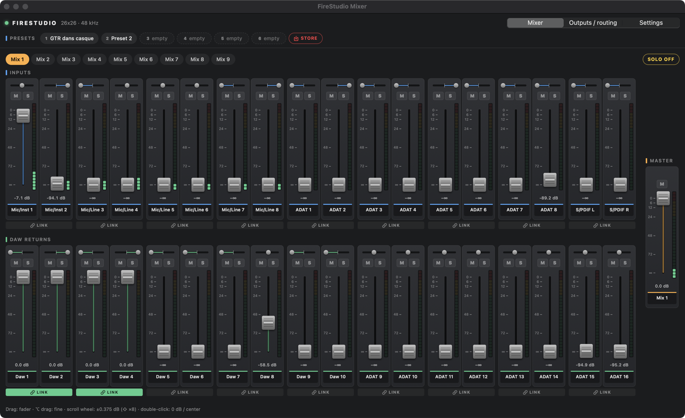

# OpenControl for PreSonus FireStudio

**Free software to control the DSP mixer of the original PreSonus FireStudio 26x26 (2008) on macOS 12 – 15.**
A replacement for FireControl / Universal Control, which no longer support this interface.

PreSonus ended support for the FireStudio 26x26 in 2015. With the FireWire drivers of a newer PreSonus
product the interface still works for audio, but no software can reach its internal mixer any more:
zero-latency monitoring, output routing and headphone feeds. OpenControl fills that gap.



## Features

- **9 stereo mixes**: 18 inputs and 18 DAW returns per mix, each with a fader in dB, pan, mute, solo, stereo link, plus a master fader
- **Routing**: send any input, DAW return or mix to each output pair (Out 1/2 … S/PDIF); choose the source of Main and the 3 headphone outputs
- **LED meters** with peak hold
- **6 presets** recalled with one click
- **Automatic backup** of the full device state on every connection, with restore
- Scroll wheel for fine steps (±0.375 dB, ⇧ ×8), ⌥-drag for fine adjustment, double-click to reset to 0 dB / center
- **Driver operation mode**: the latency / robustness setting Universal Control used to offer (see [docs/driver-settings.md](docs/driver-settings.md))
- **Standalone use**: settings are stored in the interface itself and keep working without a computer

## Standalone use

The FireStudio firmware stores its mixer settings itself: every change made in the app is kept by the
interface and survives a power cycle. There is no separate "save to device" step.

To use the FireStudio without a computer, set it up in the app, then quit the app and unplug the FireWire
cable. The mixes, output routing, Main and headphone sources stay active: for example, Mix 1 → Out 1/2 to
monitor the inputs on headphones or speakers. Without a computer, the DAW returns are silent and the
interface runs on its internal clock (or the selected digital clock source).

Verified on the tested setup: FireWire unplugged, interface power-cycled, an input heard on the headphones.

## Requirements

**macOS 12 – 15.** OpenControl talks to the device through Apple's `IOFireWireFamily`, which macOS 26 Tahoe
removed. It therefore does not run on macOS 26, nor on top of ASFireWire (see below).

## Tested hardware and systems

| | |
|---|---|
| Interface | FireStudio 26x26 (model `0x08`, DICE firmware 1.0.4.0) |
| Mac | Intel, macOS 12.7.6, Thunderbolt → FireWire adapter |
| Drivers | PreSonus FireWire 4.2.1 (from Universal Control 3.4.2) |

**Apple Silicon**: the app is a Universal Binary, but the PreSonus kext is x86_64 only.
OpenControl has not been tested on Apple Silicon.

**macOS 26 / Apple Silicon**: for audio on these systems, see [ASFireWire](https://github.com/mrmidi/ASFireWire).
It restores FireWire with DriverKit, and the FireStudio 2626 has been reported working with it
([issue #189](https://github.com/mrmidi/ASFireWire/issues/189)). Control of the DSP mixer is not available there yet.

## Installation

### A. Full installer (drivers + app), assembled on your Mac

This repository **contains no PreSonus binaries**. The script extracts the drivers from the official
installer, checks their PreSonus signature and version, and packages them unmodified together with the app.

1. Download **Universal Control 3.4.2** for macOS from the PreSonus website
   (`PreSonus_UniversalControl_v3_4_2_63992.dmg`).
2. In a clone of this repository (Xcode command line tools required):
   ```sh
   installer/build-installer.sh ~/Downloads/PreSonus_UniversalControl_v3_4_2_63992.dmg
   ```
3. Open `dist/OpenControl-FireStudio-<version>-full.pkg`. If macOS asks, allow the PreSonus system
   extension in *Security & Privacy*, then restart.

The resulting installer contains PreSonus drivers: keep it for your own use and do not redistribute it.

### B. App only

If the drivers are already installed, download the app from the [Releases](../../releases) page
(`.pkg` or `.zip`, Universal Binary). The app is not notarized: on first launch, right-click it and choose *Open*.

### C. From source

```sh
cd app
make ARCHS="x86_64 arm64"   # Universal Binary
make install                # copies the app to /Applications
```

## Languages

The app follows the macOS system language and falls back to English when that language is not included.
Included: English, Čeština, Dansk, Deutsch, Español, Français, Italiano, Magyar, Nederlands, Norsk bokmål,
Polski, Português (Brasil), Português (Portugal), Română, Suomi, Svenska, Türkçe.

Translations live in `app/Resources/<lang>.lproj/Localizable.strings`. The keys are the English texts.
Corrections from native speakers are welcome. `tools/check_l10n.py` (run by the CI) checks that every
language has every key, with matching format specifiers.

## How it works

The app talks directly to the DICE chip of the interface through asynchronous FireWire transactions
(`IOFireWireLib`), independently of the audio driver. The protocol is documented in
[docs/register-map.md](docs/register-map.md). Read/write probe tools are in [tools/probe](tools/probe).

FireWire access is exclusive: quit the app before using the probe tools.

## Disclaimer

OpenControl is an independent project, **not affiliated with or endorsed by PreSonus**. "PreSonus",
"FireStudio" and "Universal Control" are trademarks of their respective owners. The protocol was documented
for interoperability with hardware that is no longer supported. The software comes with no warranty. It only
writes mixer parameters, and it backs up the device state before any change.

## Related projects

- [ASFireWire](https://github.com/mrmidi/ASFireWire): FireWire stack for macOS 26 and Apple Silicon (DriverKit), including DICE audio.
- [FFADO](https://ffado.org) and the Linux `snd-dice` driver: documentation of the DICE chip.

## Acknowledgements

- [FFADO](https://ffado.org) and the Linux `snd-dice` driver (Takashi Sakamoto), for documenting the DICE chip
- The "Firestudio Catalina" project, for the idea of reusing the drivers of a newer product

## License

[MIT](LICENSE). Covers the OpenControl code only, not the PreSonus drivers.
